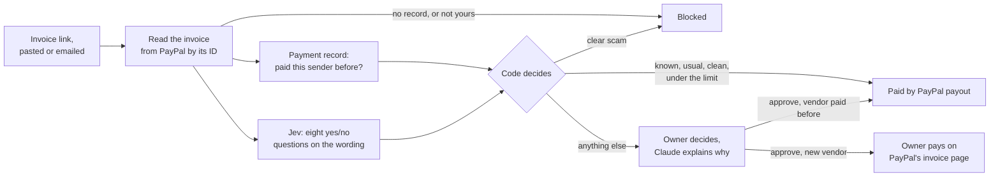

# Invoice Guard

An agent that pays a small business's PayPal invoices, and only pays the ones it can trust.

Built for the [PayPal AI Hackathon](https://paypalaihackathon.devpost.com/). It runs on the PayPal sandbox, so no real money moves.

- **Live demo:** https://invoice-guard-ov23.onrender.com. Any username, password `paypalHackathon`. The first visit can take up to a minute while the server wakes.
- **Forward an email to:** `ea17da6f59a7b1ab772e@cloudmailin.net`
- **Demo video:** _link to come_

## The problem

Fake invoices are one of the most common ways small businesses lose money. A scammer sends a convincing bill: an antivirus renewal you never bought, a supplier whose "bank details have changed", a refund for an overpayment that never happened. Someone busy pays it.

Paying invoices automatically would save that busy person time, but only if the thing doing the paying can tell a real bill from a fake one. Invoice Guard is that agent. It pays the bills it can trust, stops the obvious scams, and asks the owner about everything in between.

## What it does

Every invoice gets three checks:

| Check | Done by | Question |
|---|---|---|
| Is it real? | PayPal | Does PayPal have this invoice, and is it addressed to this account? |
| Is it expected? | The app's payment record | Has this account paid this sender before, and is the amount in the usual range? |
| Does it read like a scam? | Jev (TypeSafe AI) | Pressure, impersonation, a fee now for money later, changed payment details, and more |

Then plain code decides one of three things:

| Outcome | When |
|---|---|
| **Paid** | Real, from a sender paid before, a usual amount, clean wording, and under the owner's limit |
| **Blocked** | PayPal has no record of it, it is addressed to someone else, or the wording is clearly a scam |
| **Needs you** | Anything in between, and **every first-time sender** |

**The agent never pays a sender for the first time without asking.** Once the owner has approved and paid a vendor, that vendor's later invoices can be paid automatically.

When the agent stops on an invoice, Claude writes a two-sentence note saying what looked wrong and what to check before deciding.



### How invoices arrive

- **Forward the invoice email** to the app's address. An inbound email service (CloudMailin) posts it to `/api/inbound`.
- **Paste** an invoice link, its ID, or a whole email into the box at the top.

The email is only a pointer. The app pulls the invoice ID out of it and reads the invoice from PayPal, so a convincing email cannot change what is checked. An email that looks like PayPal but points to no real PayPal invoice is blocked on its own, and links that imitate PayPal (such as `paypa1-secure.com`) are named. That catches phishing that never touches PayPal at all.

### How it pays

- **A vendor paid before:** a PayPal payout to the vendor's verified email, at once if every check passed, or when the owner approves.
- **A first-time vendor, or one with no verified email:** the owner pays on PayPal's own invoice page, then the app confirms the payment with PayPal.
- **Never twice:** the app keeps its own record of every payment, loads past payments from PayPal's history, and builds each payout's ID from the invoice ID, so PayPal itself refuses a second payout for the same invoice.

### The owner stays in control

- **Settings** sets the most the agent may pay a known vendor on its own (default $1,000; 0 means approve everything by hand).
- **Not a scam? Unblock** moves a blocked invoice back to the owner. It is offered only when PayPal confirms the invoice is real and addressed to this account, and the invoice still needs approval before anything is paid.

## Try it

Open the [live demo](https://invoice-guard-ov23.onrender.com) (password `paypalHackathon`). The dashboard already holds a set of demo invoices: a regular lawn-care vendor, a first-time window cleaner, and a scammer using made-up business names.

Things to try:

1. **Open the blocked Greenleaf Lawn Care invoice for $118.** A vendor the account has paid before, at an ordinary amount, and the agent still stops it, because the note says the bank details changed and asks you not to call.
2. **Paste `INV2-AAAA-BBBB-CCCC-DDDD`** into the top box. PayPal has no such invoice, so it is blocked.
3. **Paste a fake PayPal email,** for example:
   `Your PayPal invoice for $612.00 is overdue. Pay now at https://paypa1-secure.com/invoice to avoid suspension.`
   It is blocked as an email with no real invoice and a look-alike link.
4. **Forward any email to `ea17da6f59a7b1ab772e@cloudmailin.net`** and watch it appear within about 15 seconds.
5. **Approve the $1,450 Greenleaf invoice** held as unusually large. It is paid at once by payout, in sandbox money.

## How it uses PayPal

| PayPal API | Used for |
|---|---|
| Invoicing v2: show invoice details | The "is it real?" check. A recipient can read an invoice by its ID; an unknown ID returns "not found" and an invoice addressed to someone else is refused |
| Invoicing v2: the invoicer's email | The vendor's identity. PayPal refuses to send an invoice whose sender email is not the sender's own, so it can be trusted |
| Payouts | Paying known vendors, with the payout ID derived from the invoice ID to stop duplicates |
| Transaction Search | Loading past payments, so vendors paid before the app was connected count as known |
| PayPal's invoice page | Paying first-time vendors, so the invoice closes properly on PayPal |

Two things we learned in the sandbox shaped the design:

- **An account cannot list the invoices it has received**, only the ones it sent. So invoices reach the app by email or paste, and PayPal is then asked for each one by its ID.
- **There is no API for a payer to pay an invoice.** A payout moves the money but leaves the invoice open on PayPal until the vendor marks it paid. First-time vendors are therefore paid on PayPal's own page.

## How it uses AI

**Jev** (TypeSafe AI, model `jev-1.13.0`) scores each invoice's wording. Jev returns probabilities rather than text, so each invoice gets eight yes/no questions in one call, answered in about 60 to 250 ms:

- Is this a scam or fraud attempt? (this one decides)
- Does it claim to come from a well-known company, bank, or agency?
- Does the sender's name conflict with their email address?
- Does it tell you to call a phone number to cancel or dispute?
- Does it threaten consequences or rush you?
- Does it describe a charge you may not have authorized?
- Does it ask for a fee now in return for more later?
- Does it steer you to a link, changed payment details, or secrecy?

The overall question sets the verdict (block at 80% or above, ask above 20%). The others become the reasons the owner sees.

**Claude** (`anthropic/claude-sonnet-5.5`, through OpenRouter) writes the short note shown when the agent stops on an invoice. It is told to use only the facts given, never to give a verdict, and to treat the invoice text as data, because a scammer wrote it. Without an OpenRouter key the app shows the plain reasons instead.

**Plain code makes every decision.** The models judge wording and write notes; whether to pay, block, or ask is decided by tested rules in `src/lib/decide.ts`, together with facts the models cannot be talked out of: whether PayPal has the invoice, and whether this account has paid the sender before.

## Run it yourself

You need Node.js 22 or newer (23.6 or newer for the demo script), a PayPal developer account, and a TypeSafe API key.

**1. PayPal sandbox.** In the [developer dashboard](https://developer.paypal.com/dashboard/), use two sandbox business accounts, each with a REST app:

- the **protected business**, whose app needs **Invoicing** and **Transaction search** switched on under Features;
- a **vendor** that sends it invoices, whose app needs **Invoicing**.

The demo script can also use a third and fourth account (a new vendor and a scammer).

**2. Install and configure.**

```bash
npm install
cp .env.example .env
```

Fill in `.env`; each setting is explained in the file. `OPENROUTER_API_KEY` is optional.

**3. Start the app.**

```bash
npm run dev
```

Open http://localhost:3000. No database setup is needed: locally the app keeps an embedded Postgres in `.data/`. With `DATABASE_URL` set it uses that Postgres instead.

**4. Fill it with demo invoices** (optional). This sends eight invoices from the sender accounts and checks each one in the app:

```bash
node --env-file=.env scripts/demo-invoices.mts --check http://localhost:3000
```

**Tests:**

```bash
npm test
```

**Deploying:** `render.yaml` is a Render Blueprint for the app and its Postgres database. Secrets are entered in the Render dashboard. Setting `DEMO_PASSWORD` puts the whole site behind one shared password.

## Project layout

| Path | What it is |
|---|---|
| `src/lib/review.ts` | Runs the checks for one invoice, pays when safe, and handles approve, reject, unblock, and confirm |
| `src/lib/decide.ts` | The rules that turn the three checks into a verdict. Covered by tests |
| `src/lib/paypal.ts` | Reading invoices, payouts, and payment history from PayPal |
| `src/lib/jev.ts` | The eight questions sent to Jev |
| `src/lib/explain.ts` | The note Claude writes for the owner |
| `src/lib/email.ts` | Finding invoices and look-alike links in an email |
| `src/lib/history.ts` | Loading past payments from PayPal |
| `src/app/` | The dashboard and the API routes |
| `scripts/demo-invoices.mts` | Fills the sandbox with demo invoices |
| `spike/` | The Python experiments that tested Jev and the PayPal sandbox before the app was written |

## Limits

- **Accuracy figures are not established.** Jev was tested on 53 sample requests, all written for this project: it got 24 of 24 easy ones and 25 of 29 harder ones right, and stayed unsure on 14 of the hard ones. That shows the approach works; it is not a measured accuracy.
- **A made-up brand can stay under the block line.** A fake antivirus renewal from "SecureShield" scored 69%, so it went to the owner instead of being blocked. Nothing was paid, because the sender was new.
- **Bland fake invoices read as normal.** A fake toner invoice has nothing wrong in its wording. The payment-record check catches it (an unknown sender is never paid automatically); Jev alone would not.
- **A payout leaves the PayPal invoice open** until the vendor marks it paid.
- **PayPal's history lags by hours,** so the app relies on its own payment record for anything recent.
- **In the sandbox,** paying an invoice on PayPal's page while signed in as a business account failed; signing in as a personal account worked.
- **One business per deployment,** behind one shared password. A real product would need proper sign-in.

## Credits

- Interface based on the [Sales Dashboard Design](https://www.figma.com/community/file/1153320445661469840/sales-dashboard-design) Figma community file by Design with Will.
- Business names in the demo are made up.

## License

MIT. See [LICENSE](LICENSE).
